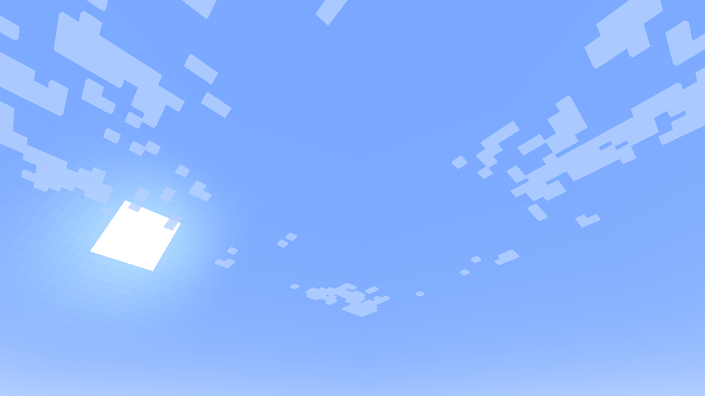

# SkyLyrics

Mod **solo cliente** para Minecraft **1.20.1**, Forge **47.x** y **Java 17**.
Muestra letras sincronizadas como texto flotante anclado al mundo, sin entidades
ni instalación en el servidor.



**Estado: 0.4.0 experimental.** Fuente Cormorant Garamond, distribución lateral y LRC local comprobados en un cliente
Minecraft real bajo Linux. LRCLIB comprobado mediante su API real. GSMTC y el motor Subtle Rhythm están implementados, pero **todavía no se probaron con Spotify/WASAPI en Windows**.
No se afirma compatibilidad verificada con shaders ni con modpacks concretos.

## Instalar y usar

1. Crear una instancia Forge 1.20.1 con Java 17. Compilado contra Forge 47.3.0.
2. Copiar `build/libs/skylyrics-1.20.1-0.4.0.jar` a su carpeta `mods/`.
3. En Windows 10 1809+ / Windows 11, abrir **Spotify de escritorio** y reproducir
   una canción. SkyLyrics consulta su sesión GSMTC al entrar al mundo.
4. Ejecutar `/skylyrics status` si no aparecen letras. **L** activa/desactiva la
   visualización; el atajo se puede cambiar en Controles.
5. `/skylyrics config` o el botón Config de la lista de mods abre los ajustes.

No reproduce ni descarga audio musical, no usa la API privada de Spotify, no solicita
contraseñas y no necesita Premium. Para letras online necesita Internet y que
LRCLIB tenga una versión sincronizada que coincida con los metadatos y duración.
Anuncios, podcasts y canciones sin duración/letras válidas pueden no mostrar texto.

El binario compilado también está incluido en `dist/`, con su SHA-256 en
`dist/SHA256SUMS`, para descargarlo directamente desde este repositorio.

## Anclaje absoluto

Cada aparición recibe un `WorldAnchor(x, y, z, escala, yaw, pitch, roll, límites)` inmutable.
El posicionador se invoca una sola vez desde el tick de creación. El renderizador
solo calcula `ancla - cámara`, que es una transformación de vista.

- Acercarse, alejarse, girar o pasar debajo cambia la perspectiva, nunca el ancla.
- Billboard rota los glifos alrededor del ancla sin desplazarla.
- Las coordenadas y la escala base no se adaptan al movimiento posterior del jugador.
- La entrada anima la opacidad y la escala local del 95% al 100%. No hay traslación vertical.
- Al cambiar de canción, las anteriores se retiran en 350 ms reales, incluso si el nuevo tema está pausado.
- No se recrea una frase para mantenerla visible. Ocultarla y reactivarla no la
  vuelve a generar. Si no se puede colocar al nacer, se omite ese intervalo.
- La caducidad se procesa aunque el texto esté fuera de pantalla o lejos.
- La pausa congela el intervalo musical. Las correcciones temporales conservan
  el mismo objeto, ID y ancla. Un seek a otro intervalo es un nuevo evento musical.
- Si se llena el límite, se omite la frase nueva sin expulsar las anteriores.
- Desconectarse/cambiar de mundo o dimensión libera las apariciones y servicios.

## Letras locales `.lrc`

Copiar archivos UTF-8 a `config/skylyrics/imports/` (crear la carpeta si hace falta).
El ejemplo original `examples/paisaje.lrc` permite probar sin Spotify ni red:

```text
/skylyrics lrc paisaje.lrc 36
```

El número es la duración en segundos. Este comando inicia un **reloj manual**;
no reproduce audio ni simula una detección de Spotify. Para acompañar música
externa hay que iniciarla manualmente y ajustar el desfase si corresponde.

Para asignar un archivo a la canción real detectada en Spotify:

```text
/skylyrics import "mi cancion.lrc"
```

Se guarda por título, artista, álbum y duración, y tiene prioridad sobre la caché
online. Los timestamps LRC gobiernan cada intervalo; una línea vacía con timestamp
marca silencio. Se admiten varios timestamps por línea, fracciones y `[offset:ms]`.
El fin de la última línea usa la duración conocida. No se inventan tiempos para
letras sin timestamps. Los marcadores por palabra de LRC mejorado se presentan por línea; los tiempos
explícitos de Lyricsfile se conservan como datos. **Esta versión no ofrece karaoke
visual por palabra**.

## Comandos cliente

No requieren operador ni mod en el servidor.

| Comando | Función |
| --- | --- |
| `/skylyrics status` | Estado de medios/letras e IDs/coordenadas activas |
| `/skylyrics spotify` | Volver a Spotify o reintentar la detección/consulta |
| `/skylyrics lrc <archivo> <segundos>` | Reproducir un timeline LRC local manual |
| `/skylyrics import <archivo>` | Asociar LRC a la canción actual de Spotify |
| `/skylyrics config` | Abrir configuración |
| `/skylyrics retry` | Reintentar letras, respetando Retry-After y LRC locales |
| `/skylyrics diagnostics [on/off/export]` | Metadatos, búsquedas, candidatos, rechazos y errores |
| `/skylyrics rhythm [on/off]` | Estado y activación explícita de captura SYSTEM |
| `/skylyrics demo` | Demo explícita de 36 s con frases originales |
| `/skylyrics anchor <texto>` | Frase de prueba de 30 s, en un punto fijo |
| `/skylyrics stop` | Detener y limpiar; Spotify se retoma con su comando |

Estados útiles: `WINDOWS_REQUIRED` (GSMTC no disponible en este sistema),
`NO_SESSION`, `BRIDGE_UNAVAILABLE`/`BRIDGE_EXITED`, `STALE_MEDIA`, `SYNCED`,
`INSTRUMENTAL`, `PLAIN_ONLY`, `NO_SYNCED_LYRICS`, `NOT_FOUND`, `NO_SAFE_MATCH`,
`INVALID_METADATA`, `AMBIGUOUS_MATCH`, `NETWORK_ERROR`, `HTTP_ERROR`,
`MALFORMED_RESPONSE`, `CONFIGURE_IDENTITY`, `RATE_LIMITED`.
Las letras locales funcionan también fuera de Windows. En error no aparece una
simulación automática. Los detalles del mecanismo Windows están en
[docs/INTEGRATION.md](docs/INTEGRATION.md).

## Recuperación de letras y diagnóstico

Primero se consulta `/api/get` con los metadatos originales. Si hace falta, se
continúa con `/api/search`, variantes normalizadas y comparación de artista,
colaboradores, título, edición y duración. Las versiones Live/acústicas/remixes y
covers se rechazan si no corresponden; ediciones ambiguas requieren selección
manual mediante LRC. Se priorizan palabras temporizadas de Lyricsfile y luego LRC.
Las letras planas no reciben timestamps inventados.

La caché conserva líneas, palabras y diagnóstico. Los reintentos tienen límites y
respetan Retry-After incluso al recrear el servicio. `/skylyrics diagnostics`
explica la causa concreta; `diagnostics export` guarda el informe completo local.
Detalles y reglas: [docs/LYRICS_RECOVERY.md](docs/LYRICS_RECOVERY.md).

## Subtle Rhythm: opcional

**Desactivado por defecto.** `/skylyrics rhythm on` habilita análisis WASAPI de
la **mezcla de salida del sistema** mientras Spotify reproduce. Puede incluir
el juego y otras aplicaciones; no es captura exclusiva de Spotify. No graba
archivos ni envía audio. `/skylyrics rhythm off` detiene la captura.

El RMS, los graves de 40–180 Hz y transitorios reales modulan hasta 102% de escala
y un aclarado de color de hasta 8%, sin tocar anclas, orientación o duración.
Silencio y señales constantes no producen un metrónomo artificial. La captura
usa un auxiliar Windows aislado (.NET Framework 4.7.2 y NAudio 2.2.1 incluidos
según corresponda); el SDK .NET 8 solo hace falta para reconstruir ese auxiliar.

Estado, configuración, dependencias y límites de validación:
[docs/SUBTLE_RHYTHM.md](docs/SUBTLE_RHYTHM.md). **Captura real pendiente de probar en Windows.**

## Configuración persistente

Archivo: `config/skylyrics-client.toml`. Para editar todos los campos, cerrar el
juego; la pantalla interna ofrece los ajustes principales.

| Campo | Valor inicial / significado |
| --- | --- |
| `enabled`, `spotify`, `enableBillboarding` | `true` |
| `fontStyle` | `CUSTOM` (Cormorant Garamond incluida); `VANILLA` conserva la fuente Minecraft |
| `placementMode` | `CINEMATIC`; alternativas `SIDES` / `RANDOM` |
| `sideBias` | 1.0: multiplicador de los pesos laterales |
| `leftWeight`, `rightWeight`, `elevatedWeight`, `frontWeight` | 40 / 40 / 10 / 10, normalizados |
| `heightVariation`, `rotationVariation` | 0.8 del rango vertical / hasta ±5° de roll fijo |
| `lrclibIdentity` | `https://github.com/AngelAleman15/SkyLyrics` (URL real y configurable) |
| `syncOffsetMs` | 0; positivo adelanta las letras, rango ±10 s |
| `visibility` | `SKY`: prioriza altura al nacer, con profundidad |
| `style` | `CINEMATIC`; `AMBIENT` reduce tamaño |
| `minDistance`, `maxDistance` | 12–45 bloques horizontales |
| `minHeight`, `maxHeight` | 5–25 bloques sobre los ojos; se eleva sobre copas/superficie si hace falta |
| `textScale` | 0.14 bloques por píxel a 24 bloques, calculada solo al crear |
| `textOpacity`, `color` | 0.92, 16773596 (`#FFF1DC`) |
| `fadeInDuration`, `fadeOutDuration` | 700 / 1000 ms musicales; dentro del intervalo |
| `trackChangeFadeMs` | 350 ms reales para retirar la canción anterior |
| `maxVisibleLyrics` | 4 |

`NATURAL` deja que los bloques oculten el texto; `ETHEREAL` usa texto sin prueba
visible de profundidad. `SKY` cambia únicamente la selección inicial del punto.
No se alteran cielo, shaders, iluminación del mundo ni generación de terreno.
No se incluye un efecto adicional de brillo. La sombra es sutil y no hay fondos.

Se conservan los valores de 0.2 al renombrar los campos de configuración. Los
ajustes de fuente y distribución también están disponibles en la pantalla interna.
Detalles, licencia y distribución: [docs/CINEMATIC.md](docs/CINEMATIC.md).

## Compilar

Con JDK 17 en `JAVA_HOME`:

```sh
./gradlew build
./gradlew runClient
```

En Windows: `gradlew.bat build`. ForgeGradle **6.0.42**, Forge **47.3.0**,
Gradle Wrapper **8.8**, mappings oficiales **1.20.1**. La primera ejecución
necesita red para resolver dependencias. El JAR reobfuscado se genera en
`build/libs/skylyrics-1.20.1-0.4.0.jar`.

Las pruebas predeterminadas son locales. La prueba adicional contra LRCLIB es
opt-in: ejecutar `test --rerun` con `SKYLYRICS_LIVE_TESTS=true` en el entorno.
No ejecutar esa prueba sin red disponible. El artefacto que contiene las
dependencias es el JAR sin `-slim`; Forge Jar-in-Jar incluye SnakeYAML 2.3.
Ver [validación](docs/VALIDATION.md).

## Arquitectura y rendimiento

- `SpotifyMediaService`: un proceso Windows PowerShell y un lector en background.
- `LyricsProvider` / `LrclibProvider`: búsquedas escalonadas, selección conservadora y 429/Retry-After.
- `LyricsSession` / `LyricsCache`: un worker para HTTP/disco, cancelación y revisión
  por solicitud para que resultados de canciones anteriores no aparezcan.
- `LrcParser`: líneas con tiempos reales; nunca temporiza texto plano.
- `MusicLyricsController` / `PresentationClock`: reproducción, pausas, seeks y plazos.
- `LyricsScene` / `WorldAnchor` / `WorldPhrase`: escena acotada y posiciones finales.
- `LyricsPlacementManager`: consulta inicial de chunks ya cargados y raycast acotado.
- `LyricsWorldRenderer`: evento `AFTER_PARTICLES`, sistema de fuentes de Minecraft y buffer reutilizado.
- `LyricsTypography`: fuente seleccionable y layouts acotados en caché.
- `AudioCaptureService` / `RhythmAnalyzer` / `SubtleRhythmController`: pipe local, DSP en worker y modulación visual acotada.
- `PlacementDistribution` / `PlacementGeometry`: zonas ponderadas y prevención inicial de superposición.
- `AnimationController` / `SkyLyricsConfig`: alfa/escala musicales, retiro por reloj real y configuración cliente.

No hay solicitudes HTTP ni lectura de disco en el renderizador. Los servicios se
cierran al desconectarse o salir del juego. No se han medido FPS con el modpack del
usuario. Investigación previa y fuentes: [docs/RESEARCH.md](docs/RESEARCH.md).

El código propio conserva todos los derechos reservados. **Cormorant Garamond**
(Copyright 2015 The Cormorant Project Authors) se distribuye bajo **SIL OFL 1.1**;
la licencia está en `licenses/` y dentro del JAR. Las licencias del MDK se conservan
también en `licenses/`. NAudio se distribuye bajo MIT y SnakeYAML bajo Apache 2.0;
sus licencias están en `licenses/` y dentro del JAR.
